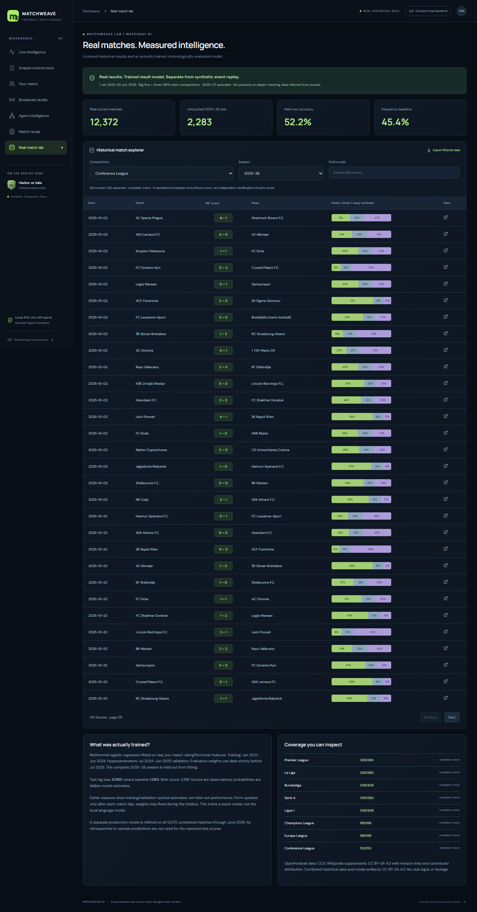

# MatchWeave AI

**Every moment has a story. Every fan gets their version.**

MatchWeave turns football events into explanations whose supporting evidence you can inspect, personalized for fans, analysts and broadcast producers. It combines Microsoft Agent Framework, optional local language-model inference and a separately trained historical match-result model.

[Demo video — 105 seconds](demos/matchweave-demo.mp4) · [Judge quick start](JUDGE_QUICKSTART.md) · [Architecture](ARCHITECTURE.md) · [Model card](MODEL_CARD.md) · [Test results](TEST_RESULTS.md)

Competition form: [ready-to-paste title, pitch, description and testing instructions](SUBMISSION_COPY_PASTE.txt).

This repository includes source, licensed datasets, trained statistical model weights, instructions, test reports, screenshots and the actual submission video. Download the video if GitHub does not play it inline. The MP4 in the repository is also the file to upload in the competition's Project Images/Video section; including it here does not submit the project to the competition.

## Run locally on Windows

1. Install **Git**, **64-bit Python 3.11+** and **Node.js 22.12+**, including npm. Ensure `git`, `python` and `npm` are available in a new terminal. The executed setup used **Windows 11, Python 3.14.7 and Node 24.19.0**; other systems and dependency combinations have not been independently verified.
2. Open PowerShell and clone the source:

   ```powershell
   git clone https://github.com/AhmedKadiwala/Match_Weave_AI.git
   cd Match_Weave_AI
   powershell -NoProfile -ExecutionPolicy Bypass -File .\scripts\run-local.ps1
   ```

   Alternatively, use **Code → Download ZIP**, extract it into a writable folder and double-click **RUN_MATCHWEAVE.cmd**. Do not run files inside the unextracted ZIP.
3. Allow the first launch to install Python dependencies, run `npm ci` and build the frontend. Internet access is needed for these downloads. The launcher does **not** download language-model weights automatically.
4. Your browser opens **http://127.0.0.1:8000/** after the combined UI/API server is ready. Keep its terminal window open. Press **Ctrl+C** to stop the server.
5. Explore **Real match lab** for historical matches and model estimates. In **Agent intelligence**, inspect recorded local-model runs or select the deterministic provider and click **Run workflow** to execute a fresh Microsoft workflow.

**No paid API key, Azure subscription or `.env` file is needed for the default local demo.** The included data and fitted result-model weights do not need to be fetched or trained again. `127.0.0.1` works only on the computer running the server; opening `frontend/index.html` directly is not a supported way to run the app.

To run setup and startup separately:

```powershell
powershell -NoProfile -ExecutionPolicy Bypass -File .\scripts\setup.ps1
.\.venv\Scripts\python.exe -m scripts.serve_local
```

If a legacy backend already occupies port 8000, stop it with `powershell -ExecutionPolicy Bypass -File scripts/stop.ps1`, then launch again. Current setup and developer scripts are under scripts/.

## Run fresh local language-model inference (optional)

With the application running, open a second PowerShell terminal in the repository and run:

```powershell
.\.venv\Scripts\python.exe -m scripts.local_model
```

This explicitly downloads Qwen2.5 1.5B if missing and starts Microsoft Foundry Local on your computer. Wait until the model service is ready and keep that terminal open. In **Agent intelligence**, select **Local model · Foundry / Ollama** and click **Run workflow**. Foundry Local is the tested provider; Ollama was not executed in the recorded verification. See [the local AI guide](docs/LOCAL_AI.md) for hardware/runtime details and overrides.

## Why this is an AI project without a paid AI API

- **Local language model:** Qwen2.5 1.5B performs inference through Foundry Local. Microsoft Agent Framework coordinates the specialist agents. The model service uses a local HTTP API on `127.0.0.1`; it does not call a paid cloud model. Actual run records are included under `demos/` and `frontend/public/artifacts/`.
- **Trained machine learning:** the historical lab loads logistic-regression weights learned from real match results and computes home-win/draw/away-win probabilities. This is fresh model inference and does not need a hosted AI API.
- **Explicit execution modes:** recorded runs replay previous AI executions. Deterministic workflows perform calculations and verification without new LLM inference. Published multilingual text uses constrained templates. These modes are labeled; neither framework orchestration nor templates alone are presented as proof of fresh generative AI.

We trained the match-result model, not the language model. See [AI_EXPLAINED.md](AI_EXPLAINED.md) for the distinction and an explanation you can use in your presentation.

## Hosting and the competition submission

A hosted website is **optional**. Official rules §4.8 allow a website, functioning demo **or test build**, and require free access for judging. The public repository with these setup instructions provides the source-based local testing route; verify it on another computer before relying on that route. A working public demo makes evaluation easier. [Official rules §§4.4 and 4.8](https://github.com/microsoft/insidethegamehackathon/blob/main/OFFICIAL%20RULES.md).

Upload the source to GitHub first, then deploy from that repository if you choose hosting. Enter the public repository URL in **Project Code Repository Link**, and upload the actual video, screenshots and architecture graphic in **Project Images/Video**. The official rules also request a publicly accessible video URL; hosting the video on YouTube or Vimeo and including its URL in the description covers that requirement as well. [Submission field guide](COMPETITION_SUBMISSION_GUIDE.md).

## Optional deployment: Vercel + Render

**Frontend: Vercel. Backend: Render Free. Health ping: Google Apps Script every five minutes.**

[Copy/paste deployment settings](DEPLOY_TO_VERCEL_RENDER.md) and [pre-upload checklist](UPLOAD_CHECKLIST.md). `render.yaml`, `requirements-render.txt`, `frontend/vercel.json`, environment examples and `GOOGLE_KEEP_ALIVE.gs` are included. No public Vercel/Render deployment or Google trigger has been created. Demo and video hosting URLs stay pending until verified.

Render executes real deterministic Microsoft Agent Framework workflows and the trained result model. The public frontend also replays actual recorded local LLM runs. Live Foundry inference runs on your PC with `python -m scripts.local_model`; the large model is not falsely advertised as running on Render Free. Public pages never silently connect to a visitor's localhost.

## What works

- Six original event-intelligence views plus the new **Real match lab**.
- Five seeded fictional scenarios / 9,887 synthetic events, event-time analytics, exact evidence recounting, a real five-specialist Microsoft workflow, visible rejection/repair, three audience personas and English/Hindi/Spanish templates.
- Player focus, SVG event/shot maps, momentum proxies, full-time recaps, broadcast previews and timed JSON export.
- **12,372 real scored main-competition matches plus 2 cancelled fixtures**, Jan 2021–Jun 2026. Big five + Champions League, Europa League and Conference League. **2026–27 excluded from both training and analysis.** Main-competition coverage counts are complete; qualifying rounds are excluded.
- Actual trained logistic-regression result models: one frozen before the 2025–26 test, another refitted on all completed matches. The result model is distinct from the local language model; final scores do not become invented pressure/tracking data.



[What is distinctive](WHAT_IS_UNIQUE.md), [real-data methods](REAL_DATA_AND_TRAINING.md), [model card](MODEL_CARD.md), [architecture](ARCHITECTURE.md), [API](docs/API.md).

## Real evidence

See [TESTING_EXPLAINED.md](TESTING_EXPLAINED.md), [TEST_RESULTS.md](TEST_RESULTS.md) and docs/reports/ for executed outcomes. The historical model's 2,283-match untouched 2025–26 test measured 52.17% accuracy versus a 45.38% frequency baseline. Full split details, log loss, Brier score and limitations are retained. It is an exploratory historical model, not an accuracy guarantee or a live feed.

The original deterministic metric/claim/overlay benchmark measured 44.624 ms p95; full workflow and local-model latency are reported separately in [BENCHMARKS.md](BENCHMARKS.md). The source-linked multilingual publication gate is independently tested across all 2,475 recorded variants.

## Regenerate

```powershell
.\.venv\Scripts\python.exe -m scripts.generate_data
.\.venv\Scripts\python.exe -m scripts.fetch_history
.\.venv\Scripts\python.exe -m scripts.train_history
.\.venv\Scripts\python.exe -m scripts.build_demo
.\.venv\Scripts\python.exe -m pytest -q
node --test scripts/tests/keep-alive.test.cjs
cd frontend
npm.cmd ci
npm.cmd run build
npx.cmd playwright install chromium
npm.cmd run test:e2e
```

`fetch_history` refreshes upstream revisions; train directly from the included snapshot to reproduce its model. Optional actual local LLM recordings use scripts/record_agents.py and scripts/evaluate_agents.py with the Foundry server running; [local AI guide](docs/LOCAL_AI.md).

## Submission assets and boundaries

[Submission text](SUBMISSION.md), [judge instructions](JUDGE_QUICKSTART.md), [file inventory](IMPLEMENTATION_INVENTORY.md), [manual actions](FINAL_MANUAL_ACTIONS.md). The actual [105-second video](demos/matchweave-demo.mp4) documents all seven views, including Real match lab and actual model recomputation; [screenshots](docs/screenshots/) and the model report provide additional evidence. [Source/static archives](deployment/release-manifest.json) are hashed and exclude credentials, downloaded model weights and local dependencies.

Original code/synthetic data/graphics: MIT. Combined real historical data, its derived artifacts and fitted model JSON: CC BY-SA 4.0, retaining OpenFootball CC0 notices and revision-linked Wikipedia contributor attribution. [Notices](THIRD_PARTY_NOTICES.md), [data license](datasets/historical/LICENSE.md), [cost audit](COST_AUDIT.md).

No real match footage, club logos or video inference is used. Tactical synthetic metrics remain documented proxies. Model notes can be wrong; unsupported prose is not published as fact. Cloud SQLite is ephemeral. Keep the static fallback available and verify public access before submitting. The provisional competition scorecard remains an internal 89/100 assessment, not a judging result.
