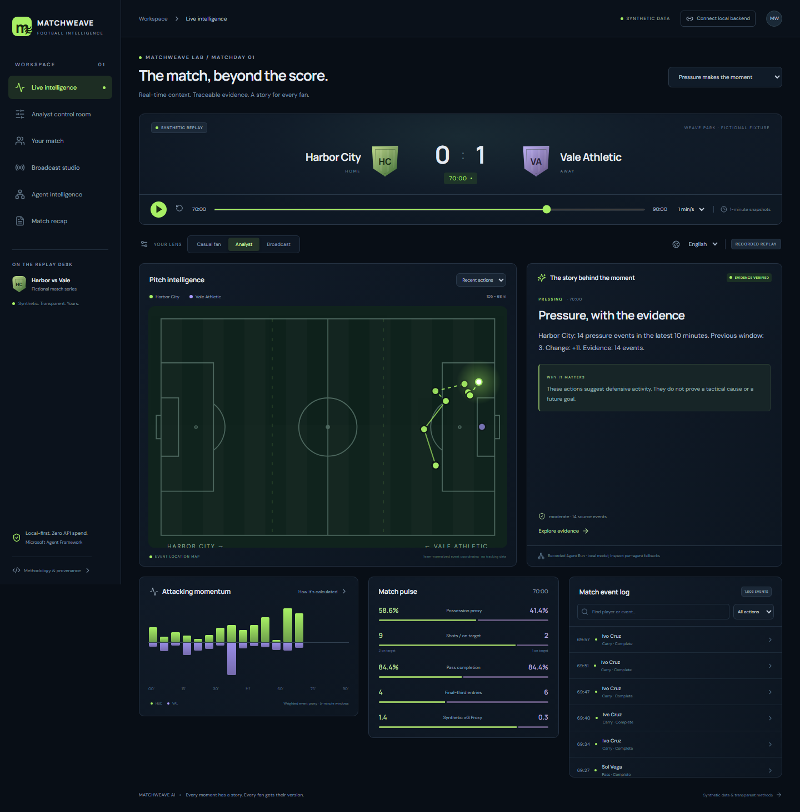
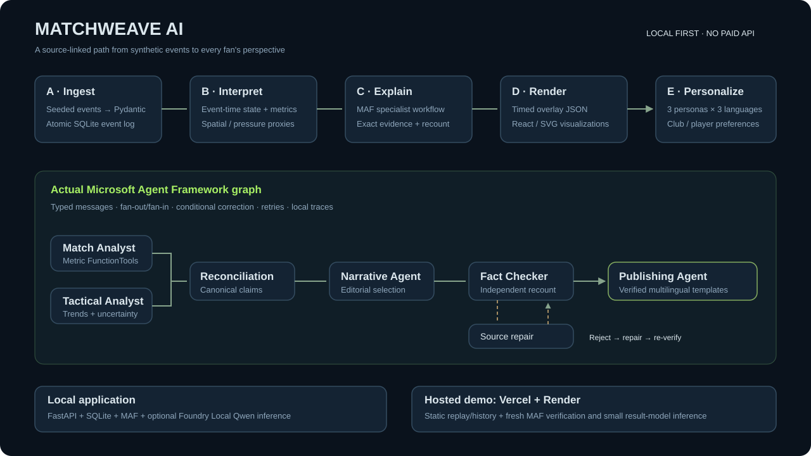

# MATCHWEAVE AI

**Every moment has a story. Every fan gets their version.**

Evidence-first football intelligence for fans, analysts and broadcast producers. Five original synthetic matches flow through deterministic football analytics and a real Microsoft Agent Framework workflow. Local Foundry agents select structured claims; an independent event recount gates every publication. English, Hindi and Spanish stories retain identical facts.



## Try it locally

Windows, Python 3.11+ and Node.js 22.12+ (tested: Python 3.14.7, Node 24.19.0, Windows 11). Use a writable local folder; the original OneDrive workspace rejected writes in the build environment.

```powershell
powershell -ExecutionPolicy Bypass -File .\scripts\setup.ps1
powershell -ExecutionPolicy Bypass -File .\scripts\start.ps1
```

Open **http://127.0.0.1:5173**. API explorer: **http://127.0.0.1:8000/docs**. No paid API keys, accounts or model downloads are needed for recorded replay or deterministic Microsoft workflows. Stop script-owned servers with `scripts/stop.ps1`.

For the already-built static demo alone: `python -m http.server 4173 --bind 127.0.0.1 --directory frontend/dist`. Never open index.html directly with file://; JSON artifacts need HTTP.

## Run genuine local AI

```powershell
.\.venv\Scripts\python.exe -m scripts.local_model
```

The optional command downloads Qwen2.5 1.5B once, loads it using Foundry Local SDK 2.1.0, and serves http://127.0.0.1:5273/v1. No Azure subscription. Keep that terminal open. In the app, connect the local backend, open Agent intelligence, choose Local model, then Run workflow. See [local model guide](docs/LOCAL_AI.md) for the exact model ID and Ollama alternative.

## What works

- Five seeded fictional 90-minute scenarios; **9,887 events**, JSON and NDJSON exports, linked shots/goals, explicit possession changes, duplicate/conflict/out-of-order validation.
- Event-time statistics, pass completion/distance, final-third entries, pressure and momentum proxies, spatial event maps, counterattack sequences, player focus and recaps.
- Five distinct local model specialists in an actual Microsoft graph: parallel match/tactical analysis, reconciliation, narrative selection, independent verification, conditional repair, publishing.
- Actual execution traces, Microsoft FunctionTool calculations, retries, timeouts, explicit per-stage fallback, a real single-agent comparison and a tested false-count correction.
- Six working React views, responsive layouts, keyboard evidence drawer, three personas and three languages, original broadcast preview and downloadable timed JSON.
- Static replay with reproducible recorded executions; fresh local Python workflows when connected. Labels distinguish recorded model runs from deterministic templates.

## Reproduce and verify

```powershell
.\.venv\Scripts\python.exe -m scripts.generate_data
# Optional: requires the local model server above
.\.venv\Scripts\python.exe -m scripts.record_agents
.\.venv\Scripts\python.exe -m scripts.record_agents --scenario pressing --failure
.\.venv\Scripts\python.exe -m scripts.evaluate_agents
.\.venv\Scripts\python.exe -m scripts.build_demo
.\.venv\Scripts\python.exe -m scripts.benchmark
.\.venv\Scripts\python.exe -m pytest -q
cd frontend
npm.cmd run build
npx.cmd playwright install chromium
npm.cmd run test:e2e
```

Recorded local runs exist for all five matches. Their measured latency is about 26–31 seconds here, independent of the fast deterministic metric/overlay path. [Benchmarks](BENCHMARKS.md) state the exact scope and limitations. [Test results](TEST_RESULTS.md) link executed reports. Do not infer model quality from role names or claim general improvements from five samples.

## Architecture and contracts



`backend/app/` contains validated models, generator, analytics, SQLite store, tools, workflow, templates and FastAPI. `frontend/src/` implements the six views and SVG charts; `frontend/public/artifacts/` contains real backend-generated replay bundles. [Architecture](ARCHITECTURE.md), [API](docs/API.md), [event schema](docs/event-schema.json), [data methods](docs/DATA_METHODOLOGY.md).

## Honest boundaries

All clubs, players and events are fictional. Pitch marks are observed event locations, not player tracking. Possession, momentum, counterattacks and Synthetic xG Proxy are documented descriptive proxies, not official Premier League statistics or calibrated predictions. Scoring anchors and some possession restarts are authored; the generator is not a continuous physical simulation. No computer vision, match footage or cloud inference is claimed.

Models make constrained editorial choices. Free-form model notes can hallucinate and remain **untrusted trace data**. Published narration uses fact-preserving multilingual templates. Inference failure is visible and falls back to deterministic selections. There is no independent human linguistic or professional football review. Replay snapshots are one-minute resolution; recorded stories are five-minute checkpoints. This is a local single-user demonstration, not an enterprise production deployment.

## Submission and public availability

**Public repository, Pages URL and video hosting are pending GitHub/portal authentication. No hackathon submission has been made.** A ready-to-publish static build, Pages workflow, actual screenshots and submission materials are included. [Deployment](DEPLOYMENT.md), [judge quick start](JUDGE_QUICKSTART.md), [submission text](SUBMISSION.md), [rules traceability](REQUIREMENTS_TRACEABILITY.md), [cost audit](COST_AUDIT.md), [final evidence scorecard](SCORECARD_FINAL.md).

Official dates: register by Oct 20 noon Pacific; submit by Oct 27 23:59 Pacific; maintain free judging access through Nov 10 23:59 Pacific. Entrant eligibility, registration and ownership must be confirmed by the entrant. [Official rules](https://github.com/microsoft/insidethegamehackathon/blob/main/OFFICIAL%20RULES.md).

MIT for original project code and synthetic datasets. Third-party dependencies retain their own licenses; [notices](THIRD_PARTY_NOTICES.md). No protected club logos, footage, paid sports data or music.
